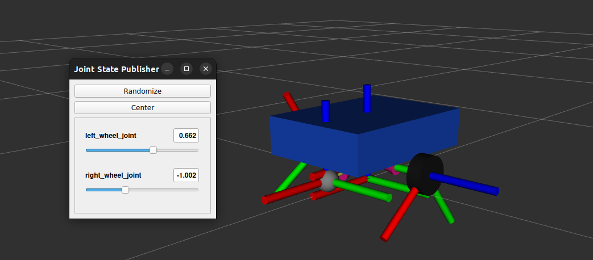
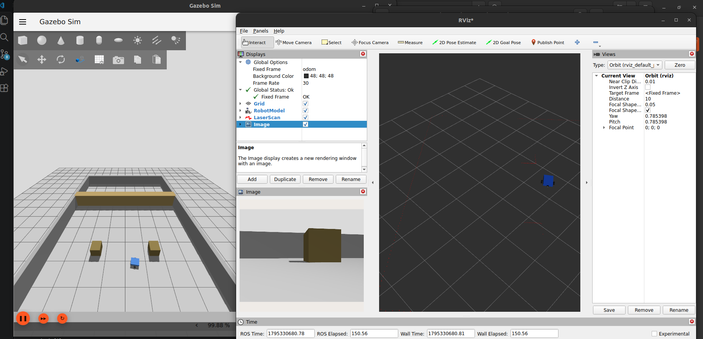

# Warehouse Mobile Manipulator (ROS 2 + Gazebo)

A simulated warehouse robot with a differential-drive base and a 3-DOF arm. It maps a warehouse, localizes itself, navigates to a shelf, detects a marked box, and picks it up.

**Stack:** ROS 2 Humble, Gazebo Harmonic, Nav2, slam_toolbox, ros2_control, OpenCV, SolidWorks, KiCad

## Status
| Week | Milestone | Status |
|---|---|---|
| 1 | Workspace and repo setup | Done |
| 2 | Chassis CAD, URDF, RViz | Done |
| 3 | Gazebo sim with sensors | Done |
| 4 | Wheel-speed PID loop tuned, step-response plots | In Progress |
| 5-6 | PID control, EKF | |
| 7-8 | SLAM, Nav2, trajectory tracking | |
| 9-11 | Arm CAD, IK, joint control | |
| 12-13 | Vision, pick-and-place | |
| 14-15 | Firmware, PCB | |
| 16 | Final demo | |

## Packages
- `wh_description`: robot model (CAD, URDF)
- (more added as the project grows)

## Setup
```bash
git clone https://github.com/ShreyasShray/warehouse-manipulator-ros2.git
cd warehouse-manipulator-ros2
colcon build
source install/setup.bash
```

## Demo

Week2 bot design and RViz -


Week3 Gazebo sim with rviz laserscan and camera view - 


## License
MIT